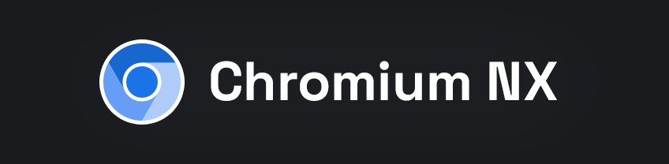

<p align="center">
  
</p>

# Chromium NX

**The Chromium web browser as a homebrew app for the Nintendo Switch and the Switch 2.**

The Linux kernel runs as a library (LKL), and on it runs Debian's
stock arm64 Chromium, unmodified, drawing with the console's GPU.
This is experimental software.

Each console has its own program, from the same release; both use the same
Chromium image (`chromium-full.ext4`):

| Console | Program | Runs under |
|---|---|---|
| Switch | `chromium-nx.nro` | Atmosphère, from a forwarder on the HOME menu |
| Switch 2 | `chromium-nx2.nro` | kaiHEN, from hbmenu |

## Install

Download the program for your console from the
[latest release](https://github.com/shodowlo/chromium-nx/releases/latest).
The launcher downloads Chromium's image (`chromium-full.ext4`, 411 MB) the
first time, or put it in `/switch/chromium-nx/` yourself.

**Switch:** copy `chromium-nx.nro` to `/switch/chromium-nx/` on the SD card.
Then create a forwarder using Sphaira (press the X button -> Install Forwarder -> set the address space to 39-bit -> Create Forwarder)
and start it from the HOME menu.

**Switch 2:** copy `chromium-nx2.nro` to `/switch/chromium-nx/` on the SD
card, then start it from hbmenu under kaiHEN.

Once installed, the launcher finds new versions itself and downloads the
program of its console.

## Features

- Chromium (Chromium 156): tabs, address bar, a profile that
  lasts, JavaScript, HTTPS, sound, hardware H.264 video.
- A launcher: search bar, Chromium, YouTube for TVs, **My sites** (your own
  pages, each with full screen, controls and portrait), 
  GitHub, Downloads, Help, Chromium's settings, and Settings
  (keyboard and mouse keys, updates, 1080p on a TV, export / import the profile, reset).
- 1080p in the dock, 720p handheld. Portrait mode. Dark theme when the console's is.
- Touch with pinch to zoom, the on-screen keyboard, a file picker for
  uploads (the SD card), downloads to `/switch/chromium-nx/Downloads`.
- Right-click with ZR where the left stick's pointer is; "Save link as"
  saves straight to the Downloads folder.
- A USB keyboard types into the page.
- Updates itself from the GitHub releases.
- On the Switch 2: its 1080p screen and 6 cores, the Joy-Con 2 as a mouse,
  and a pointer that moves smoothly even while a page loads.


## Status

Tested on real consoles: Google, Wikipedia, GitHub and YouTube work, videos
play.

- **Switch** (firmware 23.0.0, Atmosphère 1.12.1): about 60 frames a second
  on simple pages; YouTube's home page is up about 30 s after start at the
  stock clock. It is faster with the CPU overclocked. Chromium gets about
  1.9 GB of memory.
- **Switch 2** (firmware 23.0.1, kaiHEN 20261117.1): drawn with Zink
  (OpenGL ES 3.2 over Vulkan) on OunceVK. The homebrew runs in a game's
  process, which lets no fault reach it: JavaScript runs without its
  compilers (V8 `--jitless`).

Files in `/switch/chromium-nx/`: `profile.ext4` (cookies, history, logins),
`settings.ini`, `sites.ini`, `Downloads/`, `Backup/` (export), and
`chromium-nx.log`, the last run's log. The program is `chromium-nx.nro` on the
Switch, `chromium-nx2.nro` on the Switch 2.

## How it works

```
chromium-nx.nro / chromium-nx2.nro
├─ host_nx.c     Horizon side: memory, threads, screen, pad, sound, SD card, network
│                (libnx on the Switch; libounce and OunceVK on the Switch 2)
├─ LKL           Linux as a library: files (ext4 image), sockets, pipes, epoll
├─ gx            runs Linux programs on it, natively (arm64 on arm64)
│  ├─ gelf.c     loads ELF programs        gmem.c  the guest's memory
│  ├─ gsys.c     system calls              tramp.S every svc patched into a jump
│  ├─ wl.c       a Wayland compositor      glwin.c lays windows on the GPU screen
│  ├─ overlay.c  the + menu                cdp.c   Chromium's debugging pipe
│  └─ nat.c      NAT from LKL's network to Horizon's sockets
├─ launcher/     the home screen and updates (the same NRO, before the browser)
└─ guest         Debian's chromium and its libraries; libEGL / libGLESv2 /
                 libasound replaced by small ones that call the host's drivers
```

## Build

Docker containers share the project: one with Debian 12 and
`chromium:arm64` (Chromium's image, the PC test bench), one with devkitPro's
devkitA64 (the Switch), and for the Switch 2 one made from
[ounce-devkit](https://github.com/ouncebrew/ounce-devkit) (libounce and
OunceVK). Each script says at its top how its container is made.

```bash
bash gx/build-lkl.sh             # LKL for the PC bench
bash gx/build-pc.sh              # gx for PC, guest libraries, tests (NO_TESTS=1 to skip)
bash gx/build-chromium.sh        # Chromium's image
bash gx/build-nx.sh              # the Switch's NRO -> gx/dist-nx
SWITCH2=1 bash gx/build-nx.sh    # the Switch 2's NRO -> gx/dist-nx2
```

`gx/tests/run-switch2-like.sh` runs the browser on the PC under the Switch 2's
constraints (no shared memory, no JIT), where a fault has an address.

The version is in `gx/version.h` (major.minor.patch); `scripts/release.py`
publishes a release with both consoles' programs and the image (`--local
<folder>` to try updates without publishing).
The browser's options (`-F` full screen, `-R` portrait, `-M` controls, ...)
are listed in `main()` of `gx/host_nx.c`, where they are read.

## Credits

- **mnnobre** ([mnnobre/lkl-switch](https://github.com/mnnobre/lkl-switch)),
  the original project: Linux as a library inside an NRO.
- [LKL](https://github.com/lkl/linux), [libnx](https://github.com/switchbrew/libnx)
  and devkitPro, [nx-hbloader](https://github.com/switchbrew/nx-hbloader),
  Mesa, and [Chromium](https://www.chromium.org/).
- For the Switch 2: [ouncebrew](https://github.com/ouncebrew)'s kaiHEN,
  ounce-devkit, libounce and OunceVK.

The Linux kernel (LKL) is GPL-2.0; the original lkl-switch code is MIT
according to its author. Chromium and its logo are the Chromium Authors'.
Chromium NX is not affiliated with Google or Nintendo.
